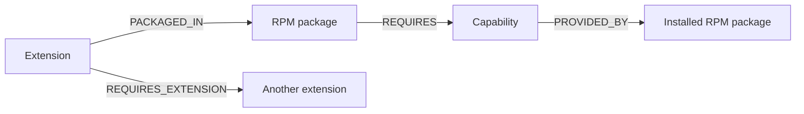

# PostgreSQL extension dependency graph

Builds PostgreSQL 18 on Rocky Linux 9 with PGDG RPM packages, attempting every available package whose name ends in `_18`. Package discovery is intentionally broad: it includes companion utilities and may miss differently named extensions or packages in disabled repositories. Rocky Linux CRB is enabled to provide libraries needed by GDAL and pgmemcache. A failed package does not prevent others from installing. This image is for inventory, not a production server. The image does not initialize or start PostgreSQL.

```sh
docker build -t pg-deps .
docker run --rm pg-deps /usr/local/bin/export-graph > inventory.sql
docker run --rm pg-deps cat /var/lib/pg-deps/failed.txt
```

In a fresh Oracle Database 23ai or later schema, run `schema.sql`, then `inventory-crb.sql` with SQLcl or SQL*Plus. The schema uses SQL property graphs. The inventory is a snapshot; create a fresh schema or clear edges followed by vertices before loading another snapshot. The schema script creates objects and is not idempotent.

Vertices represent RPMs, exact RPM requirement strings, and extension control files. Edges represent requirements, installed providers, packaging ownership, and extension control-file `requires` entries. A capability can have multiple installed providers; this shows potential providers, not the exact resolver decision. RPM requirements include version expressions and system dependencies. Extension dependencies are declared prerequisites, not runtime dependency analysis or compatibility certification. Missing extension prerequisites remain vertices without a package edge. Core contrib extensions are included when their control files are installed. Not all packages are PostgreSQL extensions or enabled in a database.

Review `/var/lib/pg-deps/candidates.txt`, `failed.txt` and `install.log` for coverage and failures. Install availability changes over time and by platform; pin base image and repositories for reproducibility. Building can take substantial time and disk space. RPM metadata and extension control files are untrusted inputs: review generated SQL before loading it into Oracle.

## Installation report

See [installation-report.md](installation-report.md) for the packages that succeeded or failed, failure causes, and the extensions present in the built image. The full build record is in [installation.log](installation.log). The current image snapshot, [inventory-crb.sql](inventory-crb.sql), is loaded in Oracle. The earlier [inventory.sql](inventory.sql) is retained as a previous snapshot. Run `./refresh-oracle.sh` to replace the existing graph data with the CRB snapshot; it deletes the existing edge and vertex rows and loads the snapshot in one transaction.

## Oracle AI Database Free

Run `./start-oracle.sh` to pull and start a dedicated 26ai Free container with a persistent volume and local-only listener on port 15219. It creates `.oracle-password` with restricted permissions for SYS/SYSTEM; keep it private. `load-oracle.sh` uses a separate `.pg-deps-password` for the application user. The loader generates that file with restricted permissions when needed. The image tag is `latest` and may change over time.

After startup run `./load-oracle.sh` to create the user in `FREEPDB1`, create the schema and SQL property graph, import `inventory-crb.sql`, and execute `graph-queries.sql`. The loader is intended for a fresh user and will stop if that user already exists; it does not drop data. To connect from a client use host `localhost`, port `15219`, service `FREEPDB1`, username `PG_DEPS`, and the password in `.pg-deps-password`. Stop and resume with `docker stop pg-deps-oracle` and `docker start pg-deps-oracle`; database files remain in the `pg-deps-oracle-data` volume.

## Graph visualization

The recommended interface is **Oracle SQL Developer Graph Visualization for VS Code**, used with the Oracle SQL Developer extension. Connect as `PG_DEPS` to `localhost:15219/FREEPDB1`, open a SQL Worksheet, and use **Visualize SQL Graph**. The queries in `projected-graph-queries.sql` return the graph vertex and edge IDs needed by the visualization.

In this environment, Graph Visualization extension **26.4.4** reported “The worksheet query has changed” and displayed no graph. Version **26.4.3** worked. If you encounter the same issue, use **Install Another Version** in the VS Code Extensions view to select 26.4.3. This is an observation from this setup; behavior in other environments or versions may differ.

The separate [Graph Server and Graph Explorer container](graph-explorer/README.md) is available as a fallback. It connects directly to the same Oracle database and can be opened in a browser; it is not required for the recommended VS Code workflow.

## Graph model

The inventory is a directed graph: vertices represent extensions, installed RPM packages, and capabilities required by RPMs. Edges describe how those vertices are related. The graph is defined in `schema.sql` and populated by `export-graph.py`.



An extension can be packaged in an RPM that requires a shared library. The requirement is represented as a capability, which can link to an installed RPM providing it. The RPM requirement does not by itself establish that the extension directly calls the library.

### Vertex types

| `kind` | Meaning | Example |
| --- | --- | --- |
| `EXTENSION` | An extension described by an installed PostgreSQL `.control` file, or a prerequisite named by one. | `vector`, `postgis` |
| `RPM` | An installed operating-system package, including PostgreSQL packages and system libraries. | `postgresql18-contrib` |
| `CAPABILITY` | An exact RPM requirement string, which can name a package, library, file, or version constraint. | `libexample.so.1()(64bit)`, `some-package >= 1.2` |

A capability is a requirement and is not necessarily a package name. One RPM can provide several capabilities, and a capability can have multiple installed providers. The exporter uses each exact requirement string as its own capability, so differently expressed requirements are distinct vertices.

`pgdep_vertex` contains `id`, `kind`, `name`, `version`, and `detail`. An RPM's `version` is its RPM version and release. An extension's `version` is the default version declared in its control file, and `detail` is that file's path. This does not establish that the extension has been created in a database. An extension named as a prerequisite can exist as a vertex without an installed control file or owning RPM.

### Relationship types

| `kind` | Direction | Meaning |
| --- | --- | --- |
| `PACKAGED_IN` | `EXTENSION → RPM` | The RPM owns the extension's `.control` file. |
| `REQUIRES` | `RPM → CAPABILITY` | The RPM declares the capability as a dependency. The edge's `detail` contains the exact requirement string. |
| `PROVIDED_BY` | `CAPABILITY → RPM` | An installed RPM was found to provide the required capability. |
| `REQUIRES_EXTENSION` | `EXTENSION → EXTENSION` | The source extension's control file names the target in its `requires` setting. |

`PROVIDED_BY` identifies matching installed providers found by the exporter. It does not record which provider the package manager selected during installation. A missing provider edge does not necessarily prove that a dependency is unsatisfied: the exporter relies on the RPM provider lookup and skips unsuccessful lookups. The exporter excludes internal `rpmlib(...)` requirements.

### Relational tables and property graph

- `pgdep_vertex` stores one row per node; `id` is its primary key.
- `pgdep_edge` stores one row per relationship; `source_id` and `target_id` reference vertices and establish direction.
- `pg_dependencies` is the Oracle SQL property graph over those tables. All vertices have the label `dependency_node`, and all edges have the label `dependency`. The specific node and relationship types are values of the `kind` property, rather than separate graph labels. All table columns are exposed as graph properties: vertex `id`, `kind`, `name`, `version`, `detail`; and edge `id`, `source_id`, `target_id`, `kind`, `detail`. The IDs are both graph keys and accessible properties for visualization.

IDs are SHA-256 hashes derived from a node's type and name, or from an edge's endpoints, type, and detail. They deduplicate repeated observations within a snapshot. Node IDs do not include version, so they identify a named node, not a particular version across snapshots.

You can inspect the model with ordinary SQL. For example, this lists declared extension prerequisites:

```sql
SELECT source.name AS extension_name,
       target.name AS required_extension
FROM   pgdep_edge e
JOIN   pgdep_vertex source ON source.id = e.source_id
JOIN   pgdep_vertex target ON target.id = e.target_id
WHERE  e.kind = 'REQUIRES_EXTENSION'
ORDER BY source.name, target.name;
```

See `graph-queries.sql` for SQL property graph examples, including extension ownership, extension prerequisites, and package requirements with installed providers. The inventory is a snapshot of the built image; it does not prove that extensions are enabled, compatible with one another, or supported in a particular deployment.

## Simplified dependency graphs

`projected-graphs.sql` creates two views and two additional SQL property graphs on the same base tables. `PG_RPM_DEPENDENCIES` collapses `RPM → capability → provider RPM` into a direct edge. `PG_EXTENSION_LIBRARIES` collapses `extension → owning RPM → capability → provider RPM` into a direct edge. The capability and original edge identifiers remain properties on each derived edge. The relationships indicate RPM requirements and installed matching providers; they do not establish that an extension directly uses a particular library.

The views calculate relationships from the current inventory; no separate snapshot refresh is needed. Each derived edge has a composite key made from its source edge IDs. Multiple capabilities and providers can produce parallel edges between the same vertices; self-edges are also possible. The graphs share `pgdep_vertex`, which includes nodes of every kind, but matching their labeled edges returns RPM-to-RPM or extension-to-RPM paths respectively. `projected-graph-queries.sql` has visualization queries with `VERTEX_ID` and `EDGE_ID`.

The fresh `load-oracle.sh` creates these graphs. For an existing installation, run `projected-graphs.sql` as `PG_DEPS`; the `CREATE OR REPLACE` definitions preserve the base data. These views require Oracle AI Database 26ai release update 23.26.1 or later.


### Grouped RPM graph

`PG_RPM_GROUPED` uses `pgdep_rpm_grouped_edge` to show one edge per source and destination RPM pair. Each edge records the number and list of distinct requirement capabilities. `schema.sql` creates the table and graph; `grouped-rpm-graph.sql` populates the grouped edges after the inventory and projected views are loaded; `refresh-oracle.sh` rebuilds its rows in the same transaction as the base inventory. The physical table is used because Graph Explorer returned vertices but omitted edges for the aggregated view in this environment. The capability list can be truncated when it exceeds the `LISTAGG` limit; `capability_count` still reports the complete distinct count.

To visualize dependencies up to three levels from `postgresql18-server` using the grouped graph:

```sql
SELECT *
FROM GRAPH_TABLE (
  pg_deps.pg_rpm_grouped
  MATCH (root IS dependency_node)
        -[IS rpm_requires]->{1,3}
        (finish IS dependency_node)
  WHERE root.kind = 'RPM'
    AND root.name = 'postgresql18-server'
  ONE ROW PER STEP (source, dependency, destination)
  COLUMNS (
    vertex_id(source) AS source_id,
    edge_id(dependency) AS edge_id,
    vertex_id(destination) AS dest_id,
    source.name AS source_rpm,
    destination.name AS required_rpm,
    dependency.capability_count AS capability_count,
    dependency.capabilities AS capabilities
  )
);
```

Change `{1,3}` to adjust traversal depth. This query returns one row per step in each matched path, so a shared edge may appear in multiple rows. A depth bound can omit deeper dependencies; cycles and shared dependencies mean the result is a network rather than necessarily a tree. The visualization may display results in batches.

## License

Project-authored material is licensed under the [Universal Permissive License, Version 1.0](LICENSE) (UPL-1.0). Downloaded Oracle software and third-party PostgreSQL packages are subject to their respective licenses and terms.
