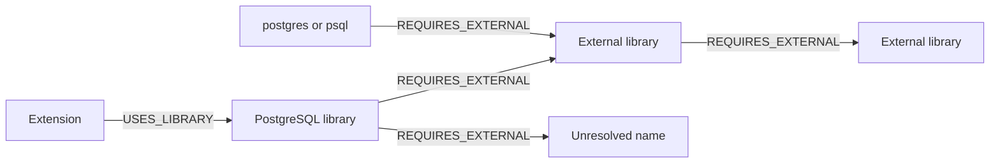

# PostgreSQL ELF dependency graph

Collect ELF dependencies for `postgres`, `psql`, and each shared object under PostgreSQL's `pg_config --pkglibdir`. The results load into an independent Oracle schema and SQL property graph. Extension names are separate vertices, related to library vertices by `USES_LIBRARY`; one library can be linked to several extensions.



The collector traverses libraries inside the PostgreSQL installation root, but collapses them from dependency paths, like the companion Oracle collector. PostgreSQL shared objects are separately retained as roots. An edge's `via` property records one internal witness path if any. External library vertices and edges are shared within a snapshot, and `via` is one witness rather than a complete list.

## Classification

Vertices have a `kind`, a `category`, and an `origin`. For libraries, `category` has these meanings:

- `POSTGRES_CORE`: a library owned by a recognized core PostgreSQL package.
- `POSTGRES_DISTRIB`: a non-extension library owned by another recognized PostgreSQL distribution package, such as a contrib or language package.
- `EXTENSION`: a PostgreSQL library explicitly named by one or more extension control files. The individual names are related vertices, not a list in the library row.
- `EXTERNAL`: a library whose canonical path is outside the PostgreSQL installation root.
- `UNKNOWN`: insufficient evidence to classify a PostgreSQL library, or an unresolved requirement whose location is unknown.

For an `EXTENSION` library, `origin` distinguishes `POSTGRES_CORE`, `POSTGRES_DISTRIB`, `THIRD_PARTY`, or `UNKNOWN`. This handles overlap: `pg_stat_statements` is an extension whose library is supplied by the PostgreSQL contrib package. Extension vertices have `category = 'EXTENSION'`; executables `postgres` and `psql` have `category = 'POSTGRES_CORE'`. `owner_package` records the package name used as evidence when `rpm -qf` is available. Package ownership is classification metadata: there are no RPM vertices, package dependency edges, or RPM dependency resolution in this graph.

The ownership rules recognize RPM names `postgresql<major>`, `postgresql<major>-server`, and `postgresql<major>-libs` as core and other `postgresql<major>-*` names as distribution packages. Other known package names are classified as `THIRD_PARTY` origin. Those rules fit this PGDG RPM image; other packaging conventions or systems may yield `UNKNOWN` or misleading provenance and should be reviewed. `category` does not certify upstream authorship or support.

A `PG_LIBRARY` is an ELF object found in `pkglibdir`; it is not necessarily an extension or enabled in a database. Each extension-to-library association comes from an explicit primary control-file `module_pathname`. `$libdir/` and absolute paths are resolved; unqualified names are checked in `pkglibdir`, the usual default search location. A missing edge means no association was established, not that the library cannot belong to an extension. SQL scripts, secondary version-specific control files, other search paths and runtime loading are not inspected for these associations. Missing or unsupported control-file targets are listed in the collection log. Scanning does not execute `CREATE EXTENSION` or determine which extensions are installed in a database.

## Collect

The existing `localhost/pg-deps:crb` image supplies Python 3, `ldd`, `readelf`, and PostgreSQL 18's `pg_config`:

```sh
mkdir -p output
./collect-image.sh > output/inventory.sql 2> output/collection.log
```

Use `PG_IMAGE` to select another image. The wrapper defaults to `/usr/pgsql-18/bin/pg_config`; override it with `--pg-config /path/to/pg_config`. On Linux run `python3 collect.py --pg-config /path/to/pg_config` in the target environment. The collector infers the installation root from the parent of `pg_config --bindir` and checks that `pkglibdir` lies within it. For nonstandard layouts pass `--pg-home /path/to/postgres/home`. Do not use a broad system directory such as `/usr` as the home: doing so would incorrectly hide system libraries.

The root file set is determined by canonical paths and deduplicated. Read the collection log for counts, skipped files, failed roots, control-file warnings and unreadable objects. A root with no edges might have no discovered external dependencies, or might have failed inspection; check the log. The collector runs `ldd` on each root: use it only with trusted binaries and libraries, since some `ldd` implementations can execute code. Resolution can depend on the container environment.

## Load and visualize

With the existing `pg-deps-oracle` database container, create a fresh independent `PG_ELF_DEPS` user and load a snapshot:

```sh
./load-oracle.sh output/inventory.sql
```

The password is in `.pg-elf-password`, created with restricted permissions. Connect as `PG_ELF_DEPS` to `localhost:15219/FREEPDB1`. The loader stops if the user exists; it does not reset or drop it. For subsequent snapshots, execute their generated SQL as this user using SQLcl or SQL*Plus. If upgrading the earlier schema, run `migrate-normalized.sql` once before loading a new snapshot. Existing snapshots keep their original data; the old `extension_names` column, if present, is retained for compatibility but is no longer a graph property or used by the collector. The normalized extension vertices, edges and classifications are available in newly collected snapshots.

Alternatively, create an Oracle schema with `CREATE SESSION`, `CREATE TABLE`, `CREATE PROPERTY GRAPH` and tablespace quota, then run `schema.sql` once followed by the inventory. The graph is `PG_ELF_DEPENDENCIES`. Use the normalized lookup or rooted graph query in `queries.sql`; select a snapshot ID and extension name or a root path. The visualization queries return `VERTEX_ID` and `EDGE_ID`. Increase traversal bounds deliberately: paths can expand quickly.

## Snapshots and visualization

A **snapshot** is one collection run covering `postgres`, `psql`, and the discovered PostgreSQL shared objects and extension associations. The collector generates a new snapshot ID on each run and assigns it to the vertices and edges in that collection. The ID does not encode the version or date. Filtering on it keeps separate runs from being mixed, and importing a new snapshot does not overwrite older snapshots.

Connect as `PG_ELF_DEPS` and list imported snapshots:

```sql
SELECT id, pg_version, prefix_path, collected_utc
FROM pg_elf_snapshot
ORDER BY collected_utc DESC;
```

Choose the desired row and use its `id` as `:snapshot_id` in the queries below. Use a normalized snapshot for extension vertices and categories; older snapshots collected before that model do not have them. The collector also records the ID as `snapshot_id` in `output/collection.log` and in a `-- snapshot:` comment at the end of the generated SQL.

### Visualize the PostgreSQL server executable

This starts at `postgres` and follows external dependencies for up to three steps. `DISTINCT` removes repeated edges reached through different paths. Increase `{1,3}` deliberately if deeper paths are needed; doing so can expand the result considerably.

```sql
SELECT DISTINCT source_id, dest_id, edge_id
FROM GRAPH_TABLE (
  pg_elf_dependencies
  MATCH (root IS dependency_node)-[IS dependency]->{1,3}(finish IS dependency_node)
  WHERE root.snapshot_id = :snapshot_id
    AND root.kind = 'POSTGRES_BINARY'
    AND root.name = 'postgres'
  ONE ROW PER STEP (source, dependency, destination)
  COLUMNS (
    VERTEX_ID(source) AS source_id,
    VERTEX_ID(destination) AS dest_id,
    EDGE_ID(dependency) AS edge_id
  )
);
```

### Visualize the full PostgreSQL collection

This returns every edge in the snapshot, including extension-to-library associations and dependencies from all scanned roots:

```sql
SELECT *
FROM GRAPH_TABLE (
  pg_elf_dependencies
  MATCH (source IS dependency_node)-[edge IS dependency]->(destination IS dependency_node)
  WHERE source.snapshot_id = :snapshot_id
  COLUMNS (
    VERTEX_ID(source) AS source_id,
    VERTEX_ID(destination) AS dest_id,
    EDGE_ID(edge) AS edge_id
  )
);
```

Both queries return the three IDs expected by Oracle SQL Developer Graph Visualization and Graph Explorer. A visualization element limit can hide edges in a large result; increase the limit or filter the graph if necessary. Vertices with no edges do not appear in edge-only output. The full collection is broader than a single Oracle executable snapshot, and the server-only query has a traversal bound, so compare their scope before drawing conclusions about complexity. Additional queries, including one rooted at an extension, are in `queries.sql`.

## Limits

The root `ldd` output is a flat resolution map. `readelf` supplies each object's direct `DT_NEEDED` names, but multiple loader contexts, RPATH/RUNPATH, duplicate names or environment changes can make a parent-child mapping ambiguous. External vertices and edges are shared across roots, so an edge represents an observation in at least one root's trace; it does not prove every root resolves that edge identically. Inspect the executable in its actual runtime environment for exact conclusions.

`dlopen`, statically linked code, workload-specific loading and other executables are not captured. PostgreSQL extensions commonly load at runtime, which is why their libraries are scanned individually. Generated SQL and logs are ignored by Git and may contain system paths and environment information. IDs are snapshot-specific, so snapshots do not overwrite each other.
